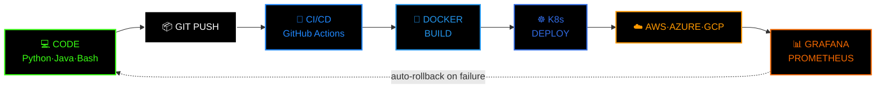

<div align="center">


<br/>


<p>
  
  
  
  
</p>


</div>

<br/>

```bash
┌──(soumyadeep@devops-node)-[~]
└─$ cat identity.yaml
```

```yaml
codename:      "Soumyadeep Jana"
role:          MCA Student — Cloud Computing & DevOps
clearance:     "root@infrastructure"
core_languages:
  python:      { purpose: automation & scripting,  level: 85% }
  java:        { purpose: backend & OOP logic,       level: 70% }
  bash:        { purpose: shell scripting & glue,     level: 80% }
  yaml:        { purpose: CI/CD & k8s manifests,       level: 90% }
weapons_of_choice:
  - Docker      # containerize everything
  - Kubernetes  # orchestrate the chaos
  - Terraform   # infra as code, no clicking around
  - Jenkins / GitHub Actions   # if it's manual, it's broken
  - AWS / Azure / GCP          # the battlefield
mission: "Break it in dev. Automate the fix. Never repeat a manual step."
contact:       soumyadeepjana368@gmail.com
```


## 💀 Tech Arsenal — Weapons Grade

<div align="center">


</div>

<br/>

<div align="center">

```
╔══════════════════════════════════════════════════════════╗
║  SKILL              LEVEL   PROGRESS                      ║
╠══════════════════════════════════════════════════════════╣
```.
| | | |
|:--|:--:|:--|
| 🐍 `PYTHON` | `85%` |  |
| ☕ `JAVA` | `70%` |  |
| 🐚 `BASH` | `80%` |  |
| 📄 `YAML` | `90%` |  |
| 🐳 `DOCKER` | `75%` |  |
| ☸️ `KUBERNETES` | `60%` |  |
| ☁️ `AWS` | `55%` |  |
| 🏗️ `TERRAFORM` | `50%` |  |
```
╚══════════════════════════════════════════════════════════╝
```

</div>


## ⚔️ Deployment Pipeline — No Manual Steps Allowed




## 📡 Live Metrics Dashboard

<p align="center">
  
  
</p>

<p align="center">
  
</p>

<p align="center">
  
</p>

<p align="center">
  
</p>

<div align="center">

### 🐍 The Snake Breaches the Grid


</div>

> ⚠️ **Reality check:** the snake + streak widgets above need a one-time GitHub Action added to *your own* repo to actually go live and pull your real contribution data — they won't auto-update just from pasting this file. Say the word and I'll generate the exact `.yml` workflow for you.


## 🏴 Achievements Unlocked

<p align="center">
  
  
  
  
  
</p>


## 📶 Establish Connection

<p align="center">
  <a href="https://www.linkedin.com/in/soumyadeep-jana-5a7610254/" target="_blank">
    
  </a>
  <a href="mailto:soumyadeepjana368@gmail.com" target="_blank">
    
  </a>
  <a href="https://instagram.com/soumyadeep.jana.7315" target="_blank">
    
  </a>
  <a href="https://twitter.com/" target="_blank">
    
  </a>
</p>

<div align="center">

### 💬 Terminal Wisdom


<br/>


**⭐ Star a repo. Fork an idea. Ship something. — root out.**

</div>
