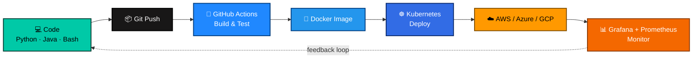

<div align="center">


<br/>


<p>
  
  
  
  
</p>


</div>

<br/>

<table align="center">
<tr>
<td valign="top" width="50%">

### 🧬 About Me

```yaml
whoami: Soumyadeep Jana
role: MCA Student — Cloud Computing & DevOps
mission: >
  Building reliable, automated,
  self-healing infrastructure
core_languages:
  - Python   🐍  automation & scripting
  - Java     ☕  OOP & backend logic
  - Bash     🐚  shell scripting & glue code
  - YAML     📄  CI/CD & K8s manifests
learning_now:
  - Terraform (IaC)
  - Kubernetes internals
  - AWS Solutions Architecture
philosophy: "If you do it twice, script it."
contact: soumyadeepjana368@gmail.com
```

</td>
<td valign="top" width="50%">

### ⚡ Quick Stats


</td>
</tr>
</table>


## 🛠️ Tech Arsenal

<div align="center">

**☁️ Cloud Platforms**
<br/>
<br/><br/>

**📦 Containers & Orchestration**
<br/>
<br/><br/>

**🔁 CI/CD & Automation**
<br/>
<br/><br/>

**🏗️ Infrastructure as Code**
<br/>
<br/><br/>

**📊 Monitoring & Observability**
<br/>
<br/><br/>

**💻 Core Languages**
<br/>
<br/><br/>

**🖥️ OS & Environment**
<br/>


</div>

<br/>

<div align="center">

| Skill | Level |
|:--|:--|
| 🐍 Python (Automation/Scripting) |  `85%` |
| ☕ Java (OOP/Backend) |  `70%` |
| 🐚 Bash (Shell Scripting) |  `80%` |
| 📄 YAML (CI/CD & K8s) |  `90%` |
| 🐳 Docker |  `75%` |
| ☸️ Kubernetes |  `60%` |
| ☁️ AWS |  `55%` |
| 🏗️ Terraform |  `50%` |

</div>


## ⚙️ CI/CD Pipeline — How I Ship Code




## 📊 GitHub Analytics Dashboard

<p align="center">
  
  
</p>

<p align="center">
  
</p>

<p align="center">
  
</p>

<div align="center">

### 🐍 Contribution Snake


</div>

> ⚠️ **Make the snake & streak stats live:** these need a small one-time setup in *your own repo* — add the `platane/snk` GitHub Action (for the snake) and make sure your username is correct on the streak-stats URL. I can generate the exact workflow YAML for you if you want it fully automated.


## 🏆 Achievements & Badges

<p align="center">
  
  
  
  
</p>


## 🤝 Let's Connect

<p align="center">
  <a href="https://www.linkedin.com/in/soumyadeep-jana-5a7610254/" target="_blank">
    
  </a>
  <a href="mailto:soumyadeepjana368@gmail.com" target="_blank">
    
  </a>
  <a href="https://instagram.com/soumyadeep.jana.7315" target="_blank">
    
  </a>
  <a href="https://twitter.com/" target="_blank">
    
  </a>
</p>

<div align="center">

### ✍️ Random Dev Quote


<br/>


**⭐ If this profile inspired you, star a repo and say hi!**

</div>
