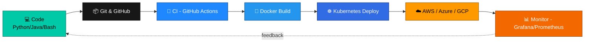

<div align="center">


<br/>


<p>
  
  
  
  
</p>

</div>


---

### 👨‍💻 About Me

```yaml
name: Soumyadeep Jana
role: MCA Student — Cloud Computing & DevOps
focus:
  - Cloud Platforms: [AWS, Azure, GCP]
  - Containers: [Docker, Kubernetes]
  - CI/CD: [Jenkins, GitHub Actions]
  - IaC: [Terraform, Ansible]
languages: [Python, Java, Bash, YAML]
philosophy: "Automate everything that can be automated"
status: Learning 🌱 | Building 🛠️ | Deploying 🚀
contact: soumyadeepjana368@gmail.com
```

---

### 🛠️ DevOps & Cloud Toolbox

<p align="center">
  
</p>

### 💻 Languages I Code In

<p align="center">
  
</p>

<div align="center">

| Language | Proficiency |
|:--------:|:-----------|
| 🐍 **Python** |  |
| ☕ **Java** |  |
| 🐚 **Bash** |  |
| 📄 **YAML** |  |

</div>

---

### 📊 GitHub Analytics

<p align="center">
  
  
</p>

<p align="center">
  
</p>

<p align="center">
  
</p>

---

### 📈 Contribution Graph

<p align="center">
  
</p>

---

### ⚙️ My DevOps Pipeline (in progress)

<div align="center">



</div>

---

### 🐍 Contribution Snake

<p align="center">
  
</p>

> 💡 To activate this animation on your own profile, add the **`platane/snk`** GitHub Action to this repo — it auto-generates the snake SVG from your real contribution graph.

---

### 🤝 Connect With Me

<p align="center">
  <a href="https://www.linkedin.com/in/soumyadeep-jana-5a7610254/" target="_blank">
    
  </a>
  <a href="mailto:soumyadeepjana368@gmail.com" target="_blank">
    
  </a>
  <a href="https://instagram.com/soumyadeep.jana.7315" target="_blank">
    
  </a>
  <a href="https://twitter.com/" target="_blank">
    
  </a>
</p>

---

<div align="center">

### ✍️ Random Dev Quote


<br/>


**Thanks for visiting! ⭐ this profile if you found it interesting.**

</div>
